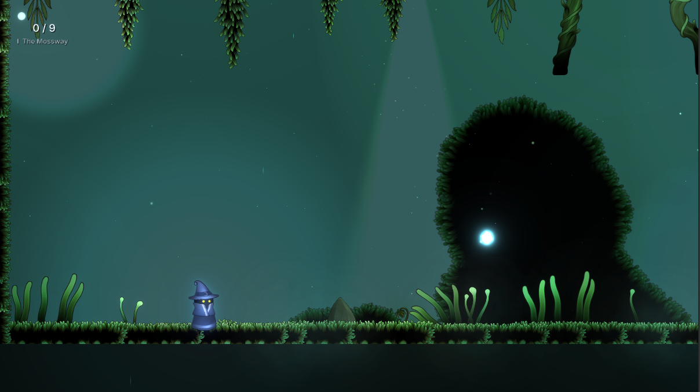
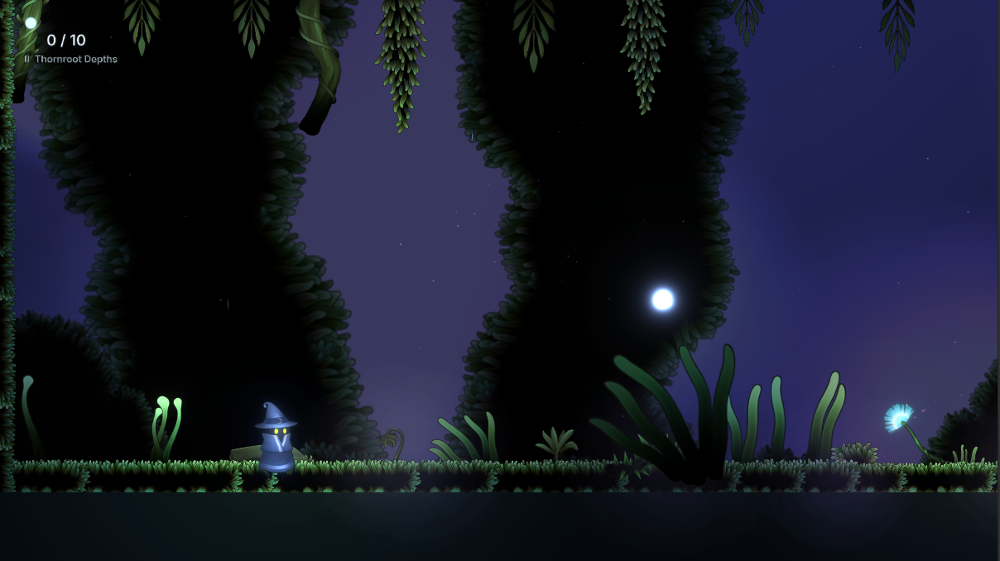
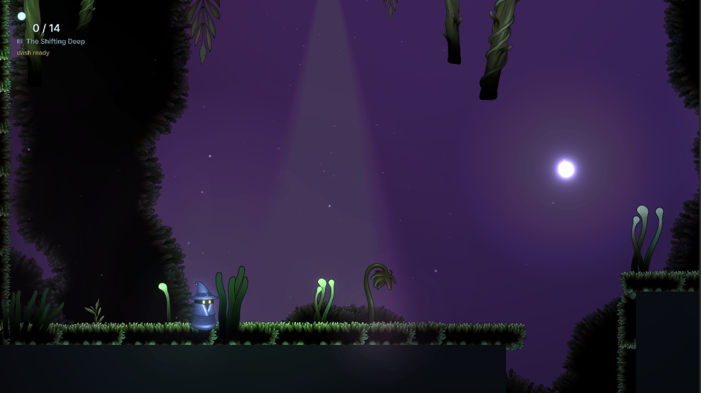
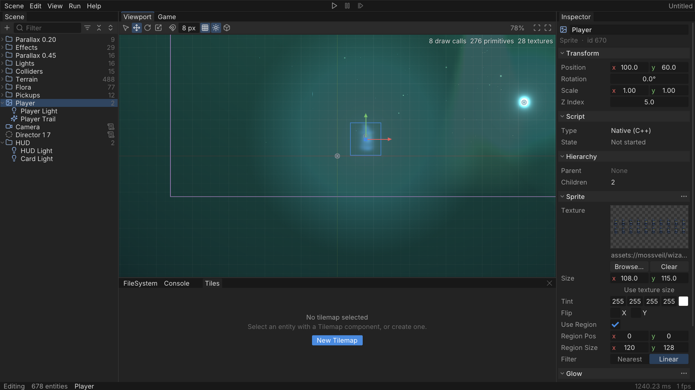
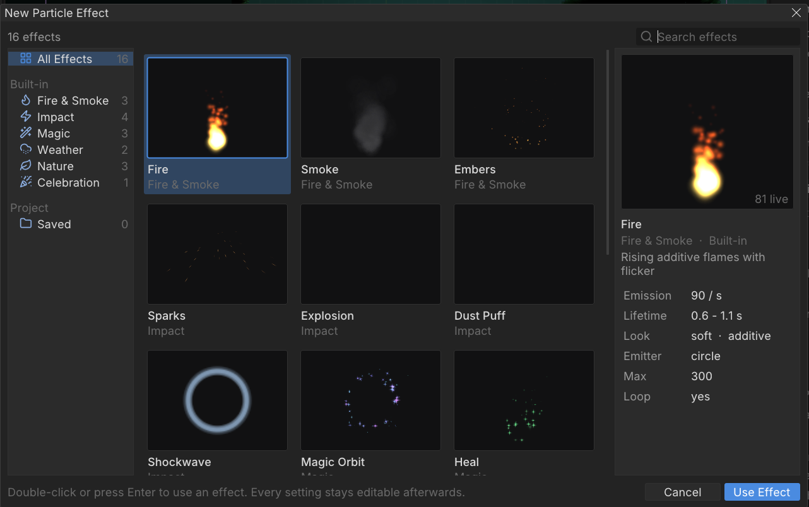

# SIMPEngine

**Version 1.0.0** · [Changelog](CHANGELOG.md)

A 2D game engine and editor written in C++20 on SDL3 and OpenGL, with an EnTT entity-component system, a batched SDF renderer, 2D lighting, particles, glow and bloom, tilemaps, audio, Lua scripting, Flutter-style tweens and vector shapes, and an ImGui editor with Play/Stop and undo. Make a game in the editor and ship it as a standalone folder.

The repository ships with **Mossveil**, a small three-level exploration game built only on the engine's public API. Its last level is procedurally generated.



| | |
|---|---|
|  |  |
| *II · Thornroot Depths* | *III · The Shifting Deep — generated from a seed* |



## Features

**Engine**
- EnTT ECS with plain-struct components and per-system update order
- Batched OpenGL renderer: sprites, SDF shapes (rect, rounded rect, circle, ring, capsule), crisp lines and SDF text in one shader, z-sorted, per-primitive view culling
- 2D lighting: point and spot lights, ambient colour, flicker, per-pixel falloff (half-resolution HDR light map)
- Particle engine with 16 built-in presets, `.particle` files, emissive particles that glow in the dark
- Glow component (per-entity glow) and screen-space bloom
- Parallax layers, camera follow with dead zone, bounds and shake
- Chunked tilemaps with flip flags, flood fill and Tiled (`.tmj`/`.tsj`) import
- Audio sources on SDL3 audio streams (WAV)
- Rigid bodies through AccelEngine
- YAML scenes that round-trip every component, a virtual file system (`assets://`)
- Lua 5.5 scripts with hot reload and script events, plus native C++ scripts (`ScriptableEntity`)
- Flutter-style tweens (curves, springs, sequences, motion paths) and vector shapes with morphing
- Character Controller component for platformer and top-down movement
- Projects (`project.simp`) and a standalone runtime (`SIMPPlayer`) for shipped games

**Editor**
- Project hub: recent projects, new projects from templates, bundled guides
- Build Game: export a project to a folder that runs anywhere; Run Standalone
- Script editor with Lua autocomplete and VS Code themes; Tween Lab
- Viewport with gizmos, snapping, marquee selection, tile painting, light/emitter/collider overlays
- Game view with Play / Pause / Step / Stop (the scene is restored on Stop)
- Undo/redo for every edit, scene files with unsaved-change prompts
- Scene tree with groups, type filters, sorting, group/ungroup and reveal-on-select
- Inspector for every component, including particle, light, audio and camera settings
- Particle effect browser with live previews, tile palette, animation maker with automatic sprite-sheet slicing
- Content browser, asset picker, console, profiler, three themes



## Building

Requirements: CMake 3.25+ (for the presets), Ninja, a C++20 compiler (tested with GCC 12 and Clang), and OpenGL 4.6 drivers. Linux is the tested platform.

All third-party libraries are git submodules in `vendor/`, so clone recursively:

```sh
git clone --recursive https://github.com/Divakar-26/SIMPEngine.git
cd SIMPEngine
```

(Already cloned? Run `git submodule update --init --recursive`.)

```sh
cmake --preset dev && cmake --build --preset dev        # Debug, build/dev
cmake --preset release && cmake --build --preset release
cmake --preset asan && cmake --build --preset asan      # Clang + AddressSanitizer
```

Run the tests (headless, no window needed):

```sh
ctest --test-dir build/dev --output-on-failure       # or ./build/dev/bin/SIMPTests [filter]
```

Start the editor:

```sh
./build/dev/bin/SIMPEditor
```

It opens the project hub. Create a project from the Platformer template, press F5 to play it, then **Project > Build Game** (Ctrl+B) to make a standalone copy. [docs/SHIPPING.md](docs/SHIPPING.md) covers projects, builds and packaging.

The sample games are separate executables:

```sh
./build/dev/Game/GameApp      # Mossveil, with the editor
./build/dev/Game/ArrowOut     # line puzzle
./build/dev/Game/Snake        # Glowworm
./build/dev/Game/Playground   # curves and morphing
```

### Packaging the engine

```sh
cmake --preset release && cmake --build --preset release
cpack --config build/release/CPackConfig.cmake      # SIMPEngine-1.0.0-Linux.tar.gz
```

Configure with `-DNO_EDITOR=ON` to build the game without the editor.

### Install as a library

```sh
cmake --preset release
cmake --build --preset release --target Engine
sudo cmake --install build/release --prefix /usr/local
```

Then in any CMake project:

```cmake
find_package(SIMPEngine REQUIRED)
target_link_libraries(MyGame PRIVATE SIMPEngine::Engine)
```

The full walkthrough, including the project layout and VS Code autocomplete, is in [docs/USING_THE_LIBRARY.md](docs/USING_THE_LIBRARY.md). The editor is not part of the installed library.

## Playing Mossveil

Press **Play** (F5) in the editor, or build with `NO_EDITOR`.

| Key | Action |
|---|---|
| A / D or ← / → | Walk |
| Space / W / ↑ | Jump (hold for higher) |
| Shift / K / X | Dash (unlocked in level II) |
| S / ↓ | Drop through a platform |
| R | Restart the level |
| N | New seed for The Shifting Deep |
| 1 / 2 / 3 | Jump to a level |

## Documentation

| Guide | What it covers |
|---|---|
| [docs/USING_THE_LIBRARY.md](docs/USING_THE_LIBRARY.md) | Install the engine and use it from your own project; VS Code setup |
| [docs/ARCHITECTURE.md](docs/ARCHITECTURE.md) | How the engine is put together: loop, layers, scene, systems, rendering, editor |
| [docs/API_GUIDE.md](docs/API_GUIDE.md) | Reference for the public API: application, scene, entities, every component, rendering, lighting, particles, audio, input, assets |
| [docs/SHIPPING.md](docs/SHIPPING.md) | Projects, the project hub, Run Standalone, Build Game, packaging the engine |
| [docs/SCRIPTING.md](docs/SCRIPTING.md) | Lua scripting: hooks, input, component handles, events, the script editor |
| [docs/ANIMATION.md](docs/ANIMATION.md) | Tweens, curves, springs, paths, vector shapes and morphing |
| [docs/HOW_TO.md](docs/HOW_TO.md) | Step-by-step recipes: first game, scripts, sprites and animation, tilemaps, particles, lights, levels, procedural generation, editor workflow |

## Project layout

| Path | Contents |
|---|---|
| `Engine/Engine/` | Engine library (`#include <Engine/...>`) |
| `Editor/` | Editor library: layer, panels, commands, undo, UI kit |
| `Apps/` | `SIMPEditor` (project hub + editor) and `SIMPPlayer` (runtime for shipped games) |
| `Game/` | Sample executables: Mossveil (`GameApp`), Arrow Out, Glowworm (`Snake`), Playground |
| `assets/` | Runtime data, addressed as `assets://...` |
| `docs/` | Guides and screenshots |
| `vendor/` | Third-party code (SDL3, SDL_image, ImGui, ImGuizmo, EnTT, GLM, glad, spdlog, yaml-cpp, nlohmann/json, nanosvg, stb, AccelEngine) |

## Credits

Mossveil's art comes from freely licensed pixel-art packs (a mossy cavern tileset, a blue wizard character and animated plants); see `assets/mossveil/SOURCE.txt`. The Knight Run sample uses the CC0 Brackeys platformer pack (`assets/platformer/LICENSE.txt`). UI fonts: Inter (OFL) and JetBrains Mono; icons: Lucide (ISC).

## License

SIMPEngine is released under the [MIT License](LICENSE). Third-party libraries in `vendor/` and fonts and art in `assets/` keep their own licenses.
